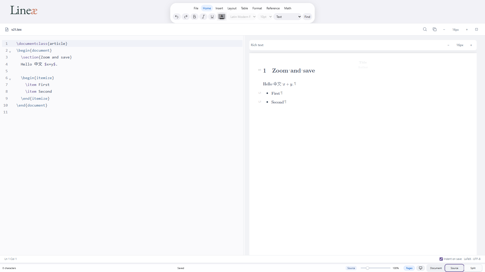
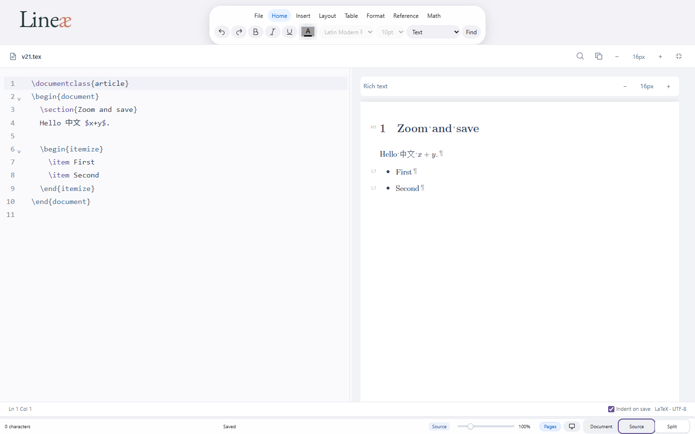
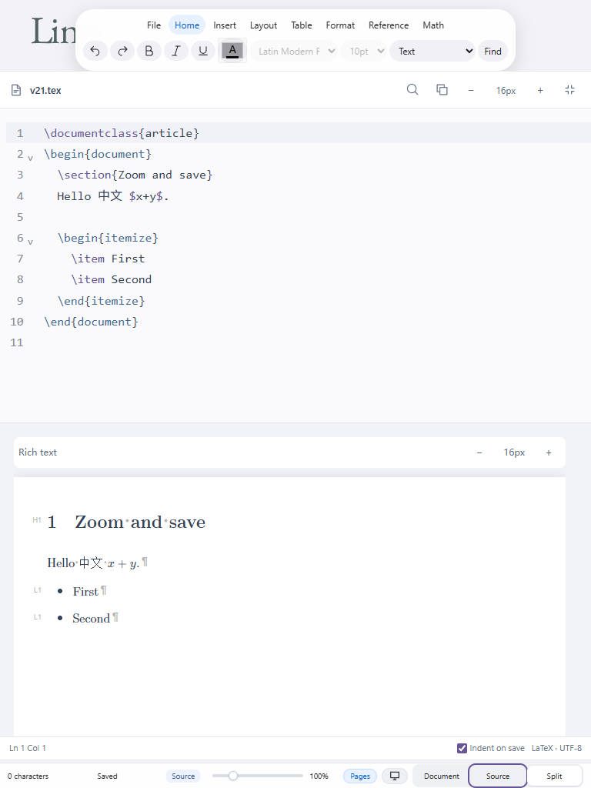
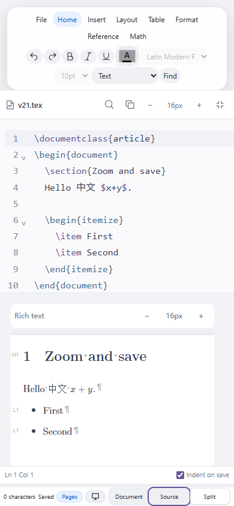

# Lineae V2.1 编辑体验验收报告

日期：2026-11-14（Asia/Shanghai）

## 1. 基线与代码保护

- PR [#14](https://github.com/AminiamEva/Lineae/pull/14) 已合并；原 V2 最新提交为 `cecac22cc6978cb34f5f02f049a1985659b867eb`。
- PR 合并提交：`4531d2dc3c0ef67e322982f039a7ade890365d38`。
- 开始工作时最新 main：`8b3db67aeb7203a75b1b42b151aeef89ecdc643e`，已通过 Git fetch 获取。
- 独立分支：`feat/editor-zoom-formatting`；独立工作树：`../Lineae-editor-v21`。
- 原 `Lineae-editor-v2` 工作树在开始和结束检查时均干净，仍位于原 V2 分支。本轮没有切换、重置、清理或修改它。
- `../Lineae-v21-evidence/v2-backup.bundle` 保存 V2 历史；`before-v2.patch`、`before-main.patch` 保存修改前差异（原树干净，因此为空）；`main-baseline.zip` 保存 main 基线源码。
- 未推送、创建新 PR、合并或部署。未修改后端、Bib 引擎、XeLaTeX 核心及 desktop 配置。

## 2. 当前代码架构

`main.js` 管理现有文档、保存入口、模式切换和快捷键路由。`source-workspace.js` 管理唯一的 CodeMirror 源码及 EOL StateField；Split 右侧复用原来的 Tiptap/ProseMirror 视图，通过已有 source projection 进行保守双向同步。本轮没有新增第二套文档状态。

依赖版本保持不变：CodeMirror state 6.5.2、view 6.38.6、commands 6.8.1、language 6.11.3、autocomplete 6.18.7；Tiptap 2.11.5；ProseMirror model 1.25.13、state 1.4.4、view 1.42.9。

## 3. 滚轮缩放与独立字号

- `editor-font.mjs` 提供默认值、范围限制、滚轮归一化及局部监听安装函数。
- Source / Rich Text 分别使用 `fontSize` 与 `richTextFontSize`；默认 16px，最小 11px，最大 32px，步长 1px。
- 原 `lineae.sourceFontSize` 偏好保留并限制到有效整数范围；新增 `lineae.richTextFontSize`。无有效偏好时使用 16px，不重置其他设置。
- Ctrl 或 Meta + 滚轮向上放大、向下缩小；无修饰键保留普通滚动。监听仅安装在 `.tex-code` 和 `.tex-preview`，不绑定全局缩放监听。
- `deltaMode` 统一为像素尺度，小增量累积到 40 后调整一次；每次最多 1px，间隔至少 60ms；空闲 180ms 或换向清理残余量。没有尾随计时任务。
- 局部事件使用非 passive 监听、`preventDefault` 和 `stopPropagation`，避免触发浏览器或原文档页面缩放；工作区以外保留原页面缩放行为。
- 两侧按钮、滚轮和快捷键分别调用同一侧的字号更新函数。达到边界时对应按钮禁用；重置按钮显示当前字号并恢复到 16px。
- Source 使用现有等宽字体、CodeMirror 自身布局和 `requestMeasure`。Rich Text 用 `--rich-text-font-size` 控制作用域排版，正文行高 1.5，标题沿用相对比例，表格行高同步。
- Rich Text 的 Ctrl/Meta 加减和归零交给局部监听处理，防止被 window 捕获阶段的原全局快捷键抢先消费。
- 状态位于工作区闭包并持久化；切换模式、拖动分栏、内容更新和重新挂载不会重置字号。所有新增事件由现有 AbortController 清理。

## 4. 保存与 LaTeX 缩进

检查确认项目具有独立 `saveDocument(saveAs)`：Ctrl/Cmd+S 和另存为使用它；支持文件系统 API 时直接写入，否则沿用 ZIP 下载回退。`downloadProject()` 是单独的项目导出入口。没有在普通输入或内容同步时执行格式化，也没有引入自动保存循环。

`latex-indent.mjs` 的 `indentLatex()` 只产生行首空格/Tab 的替换列表和保持原始分隔符的结果：

1. 以环境栈决定 2 空格层级，支持任意静态环境名称、嵌套、列表及同一行 begin/end；结束环境与开始环境对齐。
2. 跳过注释中的伪命令、转义字符和行内 `verb`。保留注释吞掉换行后下一行的原始行首，避免引入新的分隔空格。
3. 宏定义行、跨行花括号参数、跨行方括号可选参数内部保持原样；表格列声明、数学 `&`、`\\` 以及非行首字节不变。
4. verbatim、Verbatim、lstlisting、minted、alltt（以及支持的星号变体）内部完全保留，仅允许调整环境定界行的缩进。
5. 环境不匹配、未闭合结构、动态环境名、条件分支、catcode/空白语义改变、部分展开控制命令、无法安全识别的内联代码等情况整份原文返回，不猜测修复。
6. 空行及末尾是否有换行不变；多次保存幂等。

保存前把变更作为一个 `isolateHistory('full')` CodeMirror 事务应用，保留选区映射和单步撤销/重做，再同步已有富文本投影。Rich Text 模式保存时临时复用同一个源码工作区处理，再恢复原模式；源码缩进的撤销记录仍保留在 Source/Split 历史中。输入法组合输入期间跳过保存，避免打断组合。

底部增加“保存时缩进”勾选项，持久化到 `lineae.indentOnSave`，默认开启。关闭后保存保持原始格式。取消文件对话框时不会写文件，但已应用的缩进保留在编辑器中，可以一步撤销。ZIP 导出按钮本身不触发缩进；通过“保存”回退到 ZIP 时导出的是已缩进的当前源码，沿用原先的下载状态行为。

## 5. 三个模式标签

实际组件是 `main.js` 中的 `.tex-modes`，由 `body/source/split` 三个 button 组成，中文为“正文 / 源码 / 分栏”，英文为“Document / Source / Split”，当前没有标签图标。

使用 `grid-template-columns:repeat(3,minmax(0,1fr))`；整体宽度桌面 222px、窄屏 204px，按钮同高、居中、同圆角，统一 hover 和键盘 focus-visible。模式逻辑、aria-pressed、方向键/Home/End 导航保留。窄屏 Source/Split 隐藏不作用于分栏字号的页面缩放滑杆与百分比，给状态和模式按钮留出空间；两侧字号按钮仍可操作。

## 6. 新增依赖与 Bundle Size

新增依赖：**0**。`package.json` 和 `package-lock.json` 未变。

同一 esbuild 0.25.0、同一依赖目录、相同生成路径与构建参数，只替换基线源码进行比较，避免模块路径注释影响结果。生产脚本为原 `npm run build`，没有额外使用 minify。

| 项目 | main 基线 | V2.1 | 增量 |
| --- | ---: | ---: | ---: |
| editor.mjs 字节 | 2,252,738 | 2,262,659 | 9,921 |
| editor.mjs gzip 字节 | 537,028 | 539,635 | 2,607 |
| source-workspace.css 字节 | 7,660 | 9,611 | 1,951 |
| source-workspace.css gzip 字节 | 2,561 | 2,827 | 266 |

复现：`node tests/measure-v21-bundle.cjs <main 基线解压目录>`。证据见 [bundle-comparison.json](docs/v21-evidence/bundle-comparison.json)。

## 7. 修改文件清单

| 文件 | 作用 |
| --- | --- |
| `apps/web/src/editor/editor-font.mjs` | 新增字号限制与局部滚轮归一化 |
| `apps/web/src/editor/source-workspace.js` | 独立字号、两侧控件、局部监听、保存缩进事务与开关 |
| `apps/web/src/editor/latex-indent.mjs` | 新增保守结构缩进器 |
| `apps/web/src/main.js` | 接入真实保存入口，解决快捷键/页面缩放竞争 |
| `apps/web/source-workspace.css` | 富文本作用域字号与行高、控件、等宽标签、窄屏布局 |
| `tests/source-v21.test.mjs` | 新增 36 项单元测试 |
| `tests/source-v21.cjs` | 新增 61 项真实浏览器断言及截图/EOL 证据 |
| `tests/run-source-browser.cjs` | 可独立运行的源码浏览器测试入口 |
| `tests/source-v2.cjs` | 将原字号断言更新到 16–32px，保留原 V2 测试 |
| `tests/source-workspace.cjs` | 把 V2.1 测试加入原完整回归 |
| `tests/editor.cjs` | 测试静态服务器补充 SVG/PNG MIME，正确显示实际品牌资源 |
| `tests/measure-v21-bundle.cjs` | 可重复的基线体积比较 |
| 本报告及 `docs/v21-evidence/` | 截图、构建/测试日志、字节对照和校验结果 |

## 8. 测试结果

运行环境：Windows，Node.js 24.22.1，Playwright 1.56.1，Microsoft Edge Chromium 157.0.4341.46，headless 独立测试上下文。

| 验收项目 | 结果 |
| --- | --- |
| 原生产构建 `npm run build` | PASS |
| 全部 Node 测试：root、ui、Bib | 391 / 391 PASS；包含新增 36 项 |
| V2 浏览器测试 | 66 / 66 PASS |
| V2.1 浏览器测试 | 61 / 61 PASS |
| 工作区生命周期 | 6 / 6 PASS |
| 既有 EOL、dirty state、重置、history 测试 | PASS |
| 完整 `node tests/editor.cjs` | PASS，包含以上源码测试及原富文本/公式等回归 |
| 四种视口等宽、同高、文字不溢出、键盘 focus | PASS |
| `git diff --check` | PASS |

浏览器验收使用真实鼠标滚轮和键盘事件，覆盖 Ctrl、Meta、普通滚轮、左右独立按钮/快捷键/重置、11/32px 边界、模式切换、重挂载、偏好迁移、键盘和鼠标拖动分栏、富文本实际字号/行高、源码不变、真实保存入口、幂等、选区映射、撤销重做、关闭自动缩进、Rich Text 保存、ZIP 保存回退、取消保存。

文件系统 API 的最终 I/O 边界采用测试替身捕获写入内容；保存业务流程和 CodeMirror 事务运行的是生产代码。ZIP 下载使用浏览器实际下载字节验证，没有用替身替代 ZIP 导出。

复现命令（PowerShell）：

```powershell
npm run build
node --test "tests/*.test.mjs" "tests/ui/*.test.mjs" "tests/bib/**/*.test.mjs"
$env:LINEAE_CHROMIUM_EXECUTABLE = 'C:\Program Files (x86)\Microsoft\Edge\Application\msedge.exe'
node tests/run-source-browser.cjs source-v21
node tests/editor.cjs
```

未设置 `LINEAE_CHROMIUM_EXECUTABLE` 时使用 Playwright 自带 Chromium。设置 `LINEAE_V21_ARTIFACTS` 可输出截图和保存前后证据；设置 `LINEAE_EOL_ARTIFACTS` 可输出既有 EOL 回归证据。

## 9. EOL 与 SHA-256

缩进事务仅修改每一行内部的前缀，不插入或删除换行，因此现有 EOL StateField 保留每一个 LF、CRLF、独立 CR。单元测试覆盖全 LF、全 CRLF、混合分隔符、独立 CR、末尾换行/无换行、多空行，以及 CodeMirror 历史往返。

452 字节混合换行回归样例：

| 对象 | SHA-256 |
| --- | --- |
| 保存前，452 字节 | `e4015aadd42c20ca1c590e8511bbe43b6c08539f7ee0ba7cb4df6b4825dacd4e` |
| 保存后，464 字节 | `5771341b81c48bc54f8252f24392b7d4fd99e2a8da659b8b6548c29a92fb539d` |
| 保存前后 EOL 序列，共同值 | `2795d675cba72e728505ecb7b32146164491962ccbb3f013cbac375f686c48f7` |
| 去除行首缩进后的内容，共同值 | `6ddbffc2e5b705e400ed4e670c94eec71e28626f37e6dcefa8a4388871fcc89f` |

整文件哈希因增加 12 字节缩进而合理改变；EOL 哈希及非缩进内容哈希不变，末尾 CRLF 保留。撤销后恢复原 452 字节哈希。既有普通 ZIP 导出仍为原 452 字节，firstDifference = -1。

原始字节文件：[保存前](docs/v21-evidence/save-before.tex)、[保存后](docs/v21-evidence/save-after.tex)、[校验 JSON](docs/v21-evidence/eol-sha256.json)。该目录用 `.gitattributes` 禁止证据文件的换行转换，避免 Windows Git 检出污染样例。

## 10. 四种视口截图

截图展示实际运行的最终界面以及保存后缩进结果：









## 11. 边界与未完成事项

五项开发功能及本报告所列本地自动化验收已完成。

- 缩进器不执行 TeX 宏展开，无法承诺识别任意宏包改变的语法或自定义原样文本环境。已识别的不确定结构保留整份原文；特殊文件可关闭自动缩进。
- 原生 Windows/Tauri 保存对话框没有做人工点击验收；测试验证的是现有保存 API 边界前的真实业务流程、写入字节及浏览器 ZIP 回退。
- 没有在真实 macOS 或实体触控板上测试；Meta 事件和小 delta 连续输入已测试。
- Rich Text 模式下纯缩进不改变可见文档语义，其缩进历史保留在 Source/Split；Rich Text 自身仍沿用原来的内容编辑历史。
- 没有新建远程 PR、远程 CI、合并或生产部署，符合本轮“先本地验收”的边界。
