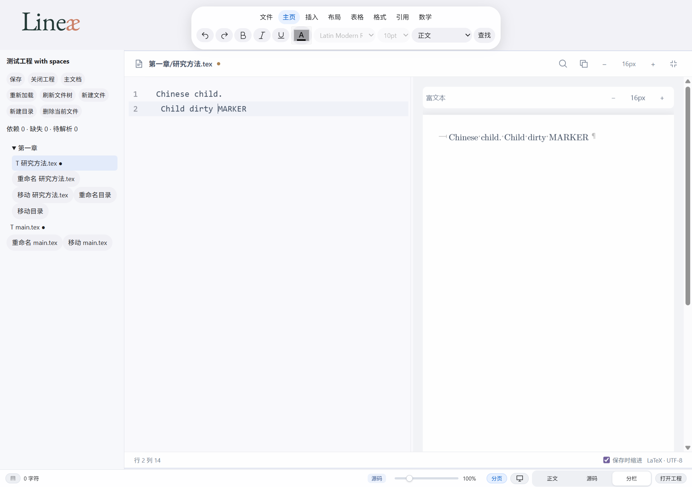
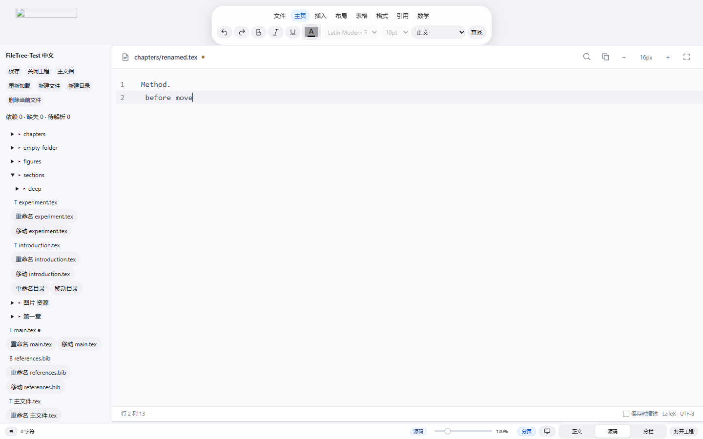
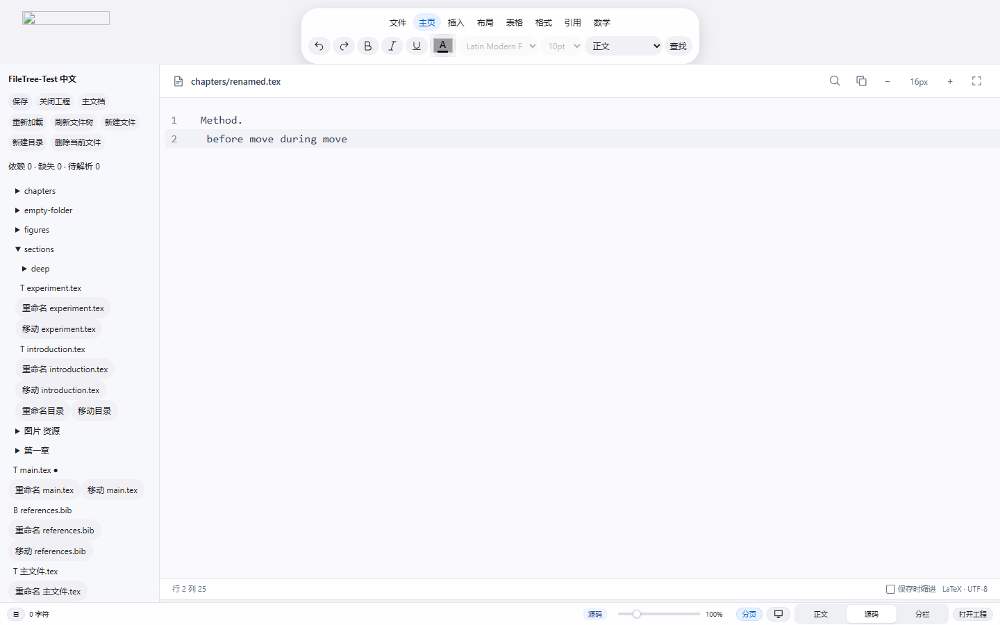

# File Tree bug bash — 2026-11-14

## PR #17 Windows CI follow-up — 2026-11-15

Initial remote run [43613857873](https://github.com/AminiamEva/Lineae/actions/runs/43613857873)
failed at `tests/project-browser.cjs:59` with OPFS `NotReadableError`. The
indentation-save test polled disk text while the save was committing, then took
another File snapshot without waiting for completion. Windows Chromium can
invalidate that snapshot across the write. The test now awaits the existing
`aria-busy=false` and successful-save status before reading exact disk bytes;
the byte equality assertion and real OPFS writes remain unchanged. No delay,
exception swallowing or retry was added.

With CI's Chromium headless shell 141 / Playwright build 1194 installed locally,
the repaired project browser suite passed all three groups. Remote rerun results
will be recorded after completion. Raw initial failure and local rerun logs are
retained under `test-results/pr17-ci/`.

## Directory concurrency follow-up

The follow-up keeps the earlier failed-run evidence below and adds a native
directory-move contract. The frontend sends the original full subtree inventory
(including empty directories) and saved file bytes. Rust checks that inventory
under a project-wide named mutex shared by Lineae instances, then performs the
existing atomic no-replace root rename. Stale membership or content rejects the
move without changing model paths. A native directory move without a manifest
is rejected; ordinary single-file moves retain their expected-byte contract.

Windows does not permit holding open descendant files across parent-directory
rename, even with all sharing enabled (verified with a real filesystem probe).
The implementation therefore does not claim an atomic snapshot against every
external editor. It detects late changes after commit, reports committed status
and a warning, and never attempts an unsafe rollback. The frontend updates the
known stable IDs/paths first and reconciles membership afterwards. Existing
editor bytes, saved text, drafts and sessions stay unchanged during that
automatic reconciliation. Changed files get a visible warning and reject save
until explicitly refreshed/reloaded; missing drafts remain recoverable. A failed
post-commit scan is reported as a moved directory needing review, not a failed
rename with the old paths still in use.

Additional coverage includes late writes, additions/deletions, a rescan error,
typing during reconciliation, and a real second Lineae process trying to save a
descendant during the directory move. Move endpoints are verified against their
actual Windows handle paths. The target parent stays open without delete
sharing through validation and rename, preventing ordinary parent/ancestor
replacement from redirecting a move. Tests include real junction replacement,
parent rename attempts, and a source directory replaced with a regular file.
A directory manifest cannot silently fall through to the single-file branch.

The native picker is now explicitly parented to the invoking Lineae window.
Previously it used the dialog library's unowned helper window; ownership is
needed for predictable modal focus. This does not by itself prove cancellation
passes: the actual interaction runner still requires a real cancellation.
The new isolated native-picker runner
observes and forwards the real bridge; it never fabricates a native return or
substitutes the filesystem. Tauri's global core export is read-only in this
build, so the recorded observation boundary is the existing project adapter.
It copies the compiled executable and DLLs to a unique test folder and records
the executable hash. A long operator wait no longer locks Cargo's build output.

### Final follow-up verification — 2026-11-15

| Check | Actual result |
| --- | --- |
| All Node tests, including real-disk model tests | 428/428 passed, zero skipped |
| Native Windows Rust tests | 21/21 entries passed, zero ignored; includes real ACL denial, exclusive handles, independent writer processes and interrupted-save recovery |
| File Tree browser scenarios | 12/12 passed, including concurrent directory changes and retained editor baselines |
| File-session browser scenarios | 5/5 passed |
| Existing project browser suite | All 3 groups passed: OPFS, real Windows disk bridge, recovery and mixed EOL |
| V2/V2.1 browser regression | Passed; 70 and 61 assertions reported |
| Web and locked Tauri desktop debug build | Passed |
| Actual Windows native picker, latest build | All 3 checkpoints passed: standalone cancel; select this run's Chinese/space path; cancel with two dirty sessions |

The actual native runner completed in `picker-1794671857171`. Both cancellations
returned `AbortError` through the real adapter, and selection returned the real
canonical Windows path. After the dirty cancellation it checked both drafts,
active file/IDs, tree expansion, selection replacement and undo, Split preference,
CodeMirror DOM identity, and unchanged on-disk content. Desktop automation clicked
the real Windows controls; WebView2 automation performed the editor assertions.
This was operator-assisted native acceptance, not an unattended CI test or a
mocked dialog. The runner then closed only its own test process tree.

The tested executable SHA-256 is
`931562f370be4c9e0e85c4191a0f03192ee9dc0dd4ec6368e56a4d82ef008bb2`.
Earlier failed attempts remain recorded: observer setup, window interference,
and cancellation arriving during the selection stage. They are not passing runs.
The final successful run supersedes the **cancellation** blocker below, but does
not imply a new full native recovery/rename/move UI run: those flows have their
earlier UI evidence plus this follow-up's fresh Rust and browser regressions.
Physical Chinese IME composition, touchpad input and power-loss testing remain
unverified; no keystroke injection is represented as those tests.

Follow-up evidence: [results and logs](file-tree-evidence/followup-checks.txt),
[native picker trace](file-tree-evidence/native-picker-result.json),
[model failures before repair](file-tree-evidence/directory-contract-before.txt).
Historical counts and cancellation failures later in this document describe
the earlier bug-bash run, not this final follow-up.

Follow-up implementation: `246237f`. The non-destructive merge `ea289fa`
establishes ancestry with merged Phase 1 main `5dabdc2`; main's tree matched
the earlier Phase 1 baseline. Existing bug-bash commits remain in history.
Delivery is [Ready for Review fix PR #17](https://github.com/AminiamEva/Lineae/pull/17)
from the existing feature branch because PR #16 is already merged. No PR merge,
release, force push or protected-workspace change.
The native operator runner is `node tests/project-native-picker.cjs`; it prints
each required selection/cancellation stage and preserves a separate result per
run under `test-results/file-tree-native/`. It is not added to unattended CI.

### Follow-up findings

| ID | Severity | Reproduction / root cause | Repair and verification |
| --- | --- | --- | --- |
| FT-20 | P0 | Change a descendant after the JS move preflight, or let a second Lineae process save while its parent is moved. Native directory moves had no saved subtree contract or shared project lock. | Require original membership/bytes in Rust, serialize cooperating instances, reject stale manifests. Real two-process and stale membership/content tests pass. |
| FT-21 | P0 | Change/add/delete a descendant at directory commit. Updating paths alone hides the new membership; adopting disk bytes would silently advance an editor's saved baseline. | Commit known stable paths, reconcile membership while preserving all existing editor baselines, mark external conflicts and refuse stale save. Model and real-disk browser tests cover clean/dirty sessions, typing during reconciliation and failed scans. |
| FT-22 | P1 | Replace a validated move parent with a junction, or replace the source directory with a file. Earlier pathname validation could address a different endpoint or fall through the file branch. | Verify opened handle paths, pin destination parent, retain directory intent. Real Windows junction/parent replacement and type-change tests pass. Arbitrary hostile reparse changes are not claimed fully prevented. |
| FT-23 | P2 | Native folder dialog had no explicit Lineae owner and could appear as an independent helper window during acceptance. | Parent the picker to the invoking Tauri window. Actual current-build selection and both cancellation checkpoints pass; tool accessibility targeting remains imperfect and is not treated as a product defect. |

This audit changes project reliability, not the math, bibliography, typography or
release roadmap. Findings below were reproduced with tests before their fixes.
The tree remains hidden on project open, and its toggle remains the first control
in the bottom status bar.

## Baseline and workspace protection

- Checkout: `C:\Users\vertin\.codex\worktrees\lineae-v3-project\Lineae-source-editor-pr`.
- Branch: `feat/project-multipage-bibliography`; initial HEAD `8755aa5`; initially clean.
- GitHub API confirmed PR #16 had already been merged. `origin/main` was
  `5dabdc2`; its tree matched initial HEAD exactly. No duplicate PR was created.
- The original `Lineae-editor-v21`, font/zoom checkout and other branches were
  not modified. No reset, rebase, force push, branch deletion, release or PR merge.
- The pre-existing project browser regression passed. It did not exercise
  input accepted during asynchronous mutations or stable tree DOM identity.
- Repair commits: `a032c69` (native mutation safety), `628d812` (model, explorer
  and editor sessions). A separate documentation/CI commit carries this report
  and evidence. Delivery uses the same remote feature branch; PR #16 remains
  merged and is not presented as a new open review for these fixes.

## Architecture reviewed

This application uses direct DOM modules, not React. React state/keys/unmount
checks therefore do not apply. `Project` owns file IDs, paths, disk baselines,
drafts, dependency metadata and recovery. `directoryTree()` derives hierarchy;
the explorer owns visibility/expansion and invokes project operations. Browser
handles and the native bridge implement filesystem operations. Rust authorizes
the root, validates paths, checks byte baselines and performs native mutations.

`main.js` supplies the explorer's session boundary. CodeMirror's immutable state
preserves selection, undo and exact source; ProseMirror renders/edits the Split
projection. The same CodeMirror view is reused. Tree state changes do not create
an editor or subscribe additional editor listeners. The explorer is installed
once for the application lifetime; closing a project drops its model/session
references and restores the suspended standalone editor.

Repairs keep those boundaries: project mutations are serialized, disk refresh
reads are staged before synchronous reconciliation, input continues to update
drafts during I/O, and switching editor sessions has a separate capture guard.
Tree DOM is rebuilt only when topology changes. Ordinary edits update labels and
active state on existing rows; detached `details` events cannot change expansion.

## Reproduced bugs and fixes

All rows are **fixed and automated-regression verified** unless qualified below.
`model` means `tests/project-tree-integrity.test.mjs`; `tree E2E` means
`tests/file-tree-browser.cjs`; `sessions E2E` means `tests/file-tree-sessions.cjs`.

| ID | Severity | Reproduction and actual behavior | Expected behavior / root cause / repair | Regression |
| --- | --- | --- | --- | --- |
| FT-01 | P0 | Edit a child, start a gated move, type again before disk completion. The later text vanished. | Preserve all input. Explorer suppressed capture while busy and reopened the old session; now captures during I/O and again before restoring the moved identity. | tree E2E: typing during move; native rename/move flow |
| FT-02 | P0 | Start reload, type while disk read waits. Returned disk text overwrote new input. | Refuse stale reload. Track draft revisions and check after the read. | model: pending reload; tree E2E: reload conflict |
| FT-03 | P0 | Edit during deletion preflight or while committed native deletion waits. File/session disappeared with new input. | Before deletion, abort on a new revision; after committed deletion, retain new edits as a missing draft and keep it active. | model: both deletion gates; tree E2E: delete/cancel/retained draft |
| FT-04 | P0 | Restore a checkpoint whose path was externally removed. Restore silently skipped that draft. | Confirmed recovery creates a missing model record without recreating a disk file; retains the available ID. TeX recovery is considered before rejecting an empty directory. | model: confirmed missing-path recovery |
| FT-05 | P0 | On Windows browser handles create `MAIN.tex` when `main.tex` exists. Case-sensitive preflight could open the existing file for writing. | Reject the case alias before `create:true`; preserve existing bytes. | model: case-alias create |
| FT-06 | P0 | Change a file after frontend preflight, then send native remove/move with old expected bytes. Rust ignored expected bytes and performed the mutation. | Validate the baseline and mutate the same native handle, denying concurrent writer/delete sharing. Bridge forwards expected bytes. | Rust: stale remove/move; bridge contract |
| FT-07 | P0 | Two native moves preflight the same absent target. A pathname rename could replace a newly created target. | Windows handle rename uses kernel no-replace semantics. Exactly one move succeeds; losing source remains intact. | Rust: competing moves |
| FT-08 | P0 | Externally modify the active clean file, refresh, then type while a later file read waits. The active baseline was already advanced; save could overwrite the external version without conflict. | Stage all reads, publish synchronously at the end, and compare original edit revisions. Concurrent typing retains the original baseline and conflicts on save. | model: staged refresh publication, failed before fix |
| FT-09 | P1 | Queue save and move concurrently. Disk awaits interleaved model/path updates. | A per-project operation queue serializes mutations while draft edits remain synchronous. A rejected operation does not poison the queue. | model: real-disk queued save/move |
| FT-10 | P1 | Rename a child `.tex` to `.bib`. Tree icon changed, but session kind and TeX dependencies stayed stale. | Update kind/scans with the path while retaining ID/draft. Reject main-to-non-TeX and editable-to-binary renames explicitly. | model: kind/metadata rename |
| FT-11 | P1 | Add/delete/rename files outside Lineae. The existing tree had no reconciliation operation. | Explicit Refresh tree reconciles paths, retains IDs/sessions at the same path, reports per-file errors and preserves missing open drafts. External renames are not guessed. | model refresh cases; tree E2E external rename/add/change |
| FT-12 | P1 | Save a missing clean file, or resolve a reference to a retained missing record. UI could report Saved; metadata said resolved. | Missing paths reject save and remain missing dependency targets. | model: missing clean file/dependency |
| FT-13 | P1 | Recovery storage throws after disk deletion. Active ID could refer to a removed record. | Finish model bookkeeping first; record checkpoint error and still attempt native persistence. | model: storage failure after delete |
| FT-14 | P1 | Open a native project through browser handles with `.lineae-*` recovery files present. Reserved path validation aborted enumeration. | Exclude reserved metadata case-insensitively while preserving it on disk. | model: browser enumeration |
| FT-15 | P1 | Use `.LINEAE-*` against native operations on Windows. Case-insensitive filesystem aliases bypassed case-sensitive protection. | Shared native component validation rejects the namespace regardless of case and invalid Windows filenames; listing excludes it. | Rust: namespace aliases and path components |
| FT-16 | P1 | Open/close a project from standalone Body/Raw/Split. Original mode, selection/undo or assets were lost; pending source projection could be stale on return. | Suspend and restore the original editor states and mode. When source is authoritative, rebuild the preview from its current text before restoring selection. | sessions E2E: Body, Raw/Split, pending projection |
| FT-17 | P1 | In Split type source then immediately Save. Preview stayed permanently stale. | Capturing a session must be read-only. It no longer cancels the pending preview update; actual restore/close still cancels obsolete work. | sessions E2E: immediate save before preview |
| FT-18 | P2 | Type or reopen the current file. Tree nodes were replaced, losing focused buttons and risking detached toggle events. | Update row status in place; no-op reopening the active file; preserve expansion/scroll and stable focus keys across topology changes. | tree E2E: DOM identity, focus, nesting; sessions E2E: stable CM view |
| FT-19 | P2 | Open a never-visited file after another file was Split. It inherited Split without its own preference. | New files start Raw; visited files restore their own Split state. | sessions E2E: repeated switching and rich undo isolation |

## Original bug-bash test matrix and actual execution (historical)

| Layer | Executed coverage | Result |
| --- | --- | --- |
| All discovered Node tests | Every `tests/**/*.test.mjs`, including real-disk model integration | 420/420, 100%, zero skipped |
| Project Node subset | Existing project tests plus 14 new tree-integrity tests | 29/29, 100% |
| Rust | Real Windows filesystem, paths, Unicode/binary moves, stale mutations, ACL/read-only/exclusive locks, save races, checkpoint processes, crash staging, destination race | 13/13 entries, 100%, zero ignored |
| Tree Playwright E2E | Full application, real Windows fixture disk behind an explicit adapter test boundary; 21 toggle clicks, hidden default, empty directory, stable nodes/focus, gated input/move/reload/delete, Chinese paths, external refresh, conflicts, long names, 200 added files, cancelled/empty project open | 11/11 scenarios |
| Session Playwright E2E | Full application with real Chromium OPFS; standalone restoration, pending preview, immediate save, per-file Raw/Split/undo/selection, 12 repeated switches, stable CodeMirror DOM | 5/5 scenarios |
| Existing project E2E | Real OPFS + Windows-backed bridge contract, create/delete/Bib source, draft recovery, conflicts, mixed EOL, reopen, 1440/900/600/390 widths | Passed |
| Full V2 browser suite | Existing editor/toolbar/completion/zoom/source/EOL checks | Passed; V2 70 and V2.1 61 assertions reported |
| Build | Web bundle; staged assets; locked Rust debug desktop build | Passed |
| Actual Tauri/WebView2 | Native folder selection, process-tree kill and confirmed recovery, external conflict, Chinese rename/move with dirty draft, save to new path | See native interaction result below |

The tree and session suites substitute the picker/adapter boundary where stated;
they are not claims of testing the OS picker or Rust. Rust tests and the actual
desktop run provide those separate layers. The generated `FileTree-Test 中文 …`
fixture includes `main.tex`, sections, nested chapters, images/PDF, Bib, empty
directory, `主文件.tex`, `第一章/研究方法.tex`, and `图片 资源/实验图片.png`.
Image/PDF bytes are resource-operation fixtures, not rendering acceptance.

Native interaction result: **partially verified, overall interactive run did not
pass**. Real Windows picker selection succeeded twice; all assertions through
recovery, external-conflict refusal, Chinese rename/move, new-path bytes and
absence of the old paths succeeded. The runner then printed
`NATIVE_PICKER_CANCEL_READY` and timed out at cancellation: the automation could
not reliably target the dialog while another window repeatedly covered it.
The log retains that failure. A fresh targeting retry was stopped after the
same interference rather than claiming success. Only the test-owned process
tree was stopped. The later refresh staging change passed its disk regression
and the final native build; a complete interactive rerun of that final build
is still pending. Native cancellation, real IME and physical power interruption
remain unverified in this audit. No simulated input is reported as IME or
native-window acceptance.

One intermediate browser rerun timed out because its missing-file check still
expected raw ENOENT after the product gained an explicit missing-file error.
The assertion was updated to require either explicit missing error; disk
nonexistence and draft preservation assertions remain. The failing log is kept.
An initial native cancel attempt timed out after window targeting interference;
its log is kept separately from the final result.

## Remaining limitations / unresolved audit items

- **Partial concurrency guarantee:** directory moves now validate a native subtree
  manifest, serialize cooperating Lineae processes, and reconcile late external
  changes without advancing editor baselines or rolling back a committed move.
  They do not freeze unrelated applications across the entire subtree. Atomic
  whole-subtree snapshots and every hostile in-place reparse-point race remain
  outside the guarantee. Large binary manifests also incur memory/IPC overhead.
- Browser File System Access lacks the native compare-and-mutate guarantee.
  Baseline checks reject observed conflicts, but arbitrary non-cooperating
  writers can still race the final browser commit. Native desktop is stronger.
- Refresh is explicit, not a background filesystem watcher. External rename
  becomes a new path plus retained missing session; it does not infer identity
  or rewrite LaTeX references. Missing drafts can be copied/exported/recovered;
  Save does not silently recreate the deleted path.
- Folder deletion, resource-file deletion UI, custom context menus, drag/drop,
  multi-select and arrow-key tree navigation were not implemented previously
  and are not introduced in this bug bash. Existing buttons and native
  `details` support Tab, Enter and Space. There is no per-file tab-close UI.
- Empty directories inside a TeX project work. A wholly empty/non-TeX project
  without confirmed recoverable TeX drafts remains rejected with a clear error;
  the previous project remains open.
- Case-only rename of an existing Windows path is rejected as a collision.
  Windows backslashes are rejected in project-relative UI paths; use `/`.
  Normalized `.`/`..` stay within the project; escaping paths are rejected.
- 200 added files were measured (about 0.8 seconds on this machine, including
  fixture I/O and UI wait). This is not a million-file/large-binary performance
  claim; project initialization still reads resource bytes and the tree is not
  virtualized. No exhaustive accessibility audit or physical touchpad test.
- Recovery journals still have Phase 1 retention/storage limits; no full
  version history, recovery-draft management UI or crash-proof last-keystroke
  guarantee is claimed.

## Evidence and changed files

Committed evidence is under `docs/file-tree-evidence/`. Screenshots support the
record; assertions and byte checks establish behavior. `move-before.png` shows
the missing late input, while `move-after.png` preserves it. The standalone
before/after captures illustrate FT-16. Full local logs remain under
`test-results/file-tree/` and `test-results/file-tree-*.log`.

Compact committed logs: [browser failures](file-tree-evidence/browser-before.txt),
[native failures](file-tree-evidence/native-before.txt),
[refresh race failure](file-tree-evidence/refresh-before.txt),
[native cancellation blocker](file-tree-evidence/native-cancel-blocked.txt),
[final automated checks](file-tree-evidence/final-checks.txt).

Product files: `apps/web/src/project/{project.mjs,paths.mjs,dependencies.mjs,explorer.js}`;
`apps/web/src/main.js`; `apps/web/src/editor/source-workspace.js`;
`apps/desktop/src-tauri/src/{project.rs,bridge.js}`.
Tests: `tests/project-tree-integrity.test.mjs`, `tests/file-tree-browser.cjs`,
`tests/file-tree-sessions.cjs`, `tests/project-native-bridge.test.mjs`,
`tests/project-tauri.cjs`, `tests/project-native-picker.cjs`. CI: `.github/workflows/desktop.yml` now includes the
three project browser suites and native integrity tests. CI has not been run
against this follow-up branch (PR #16 is already merged). Documentation: this
report and `docs/V3_PROGRESS.md`.

Local commands: discover all Node tests with `rg --files tests -g '*.test.mjs'`
then pass the full list to `node --test`; run the three project/tree browser
scripts plus `tests/editor.cjs`; `npm run build`; run
`apps/desktop/scripts/check-native.ps1`; then `node tests/project-tauri.cjs`
with the operator completing the explicitly printed native-picker steps.
The actual desktop runner kills only the app process tree it started.
