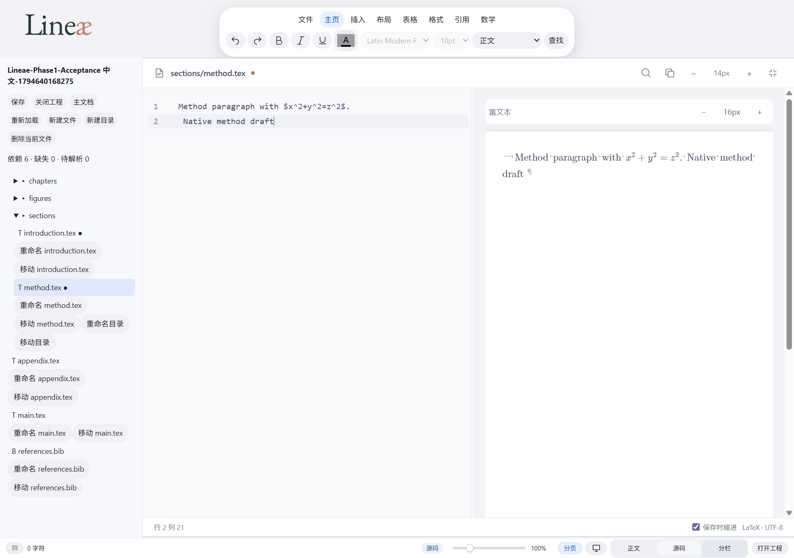
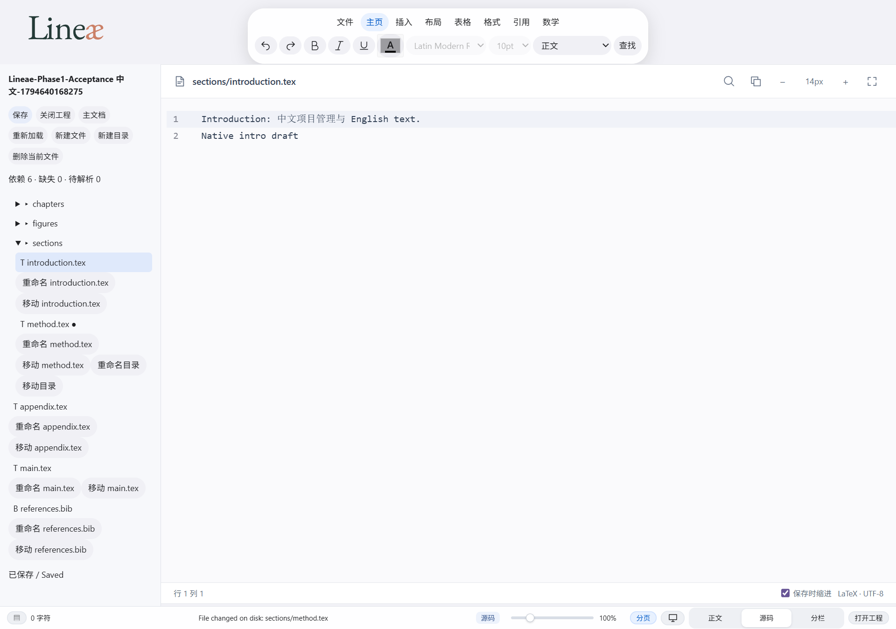

# Phase 1 final acceptance — 2026-11-14

Status: core implementation and combined-tree verification passed; ready for
formal code review. Physical Chinese IME and storage-failure edge cases below
remain explicitly unverified. This is review readiness, not a release claim.

Review delivery: [PR #16 — feat: finalize Lineae V3 project workspace](https://github.com/AminiamEva/Lineae/pull/16)
is open and non-Draft. The feature branch was pushed without force; no PR merge
or release was performed. Implementation commit: 63194d6; subsequent delivery
documentation commits do not change the verified application code.

## Baseline and integration gate

Worktree: lineae-v3-project/Lineae-source-editor-pr.
Branch: feat/project-multipage-bibliography. Starting commit: ad04942.
Implementation base: 8b3db67, including V2 PR #14.
Integrated origin/main 4bd1165950c2cf9799215cf877d13e778e0dba00 with user approval
in merge commit 6ba780c. The main.js save conflict was resolved by sharing the
explicit-save preparation step with project saving. Independent rich/source
zoom, safe save indentation, paragraph indentation and environment completion
are retained. Project Bib source is not passed through the LaTeX indenter.
Composition guards remain in effect. Both opt-out byte fidelity and opt-in
project save indentation were exercised. No upstream commits were rewritten.

The old font/zoom directory was inspected read-only; no task writes targeted it.
Its branch has independently advanced to fix/latex-environment-completion-pairing,
so this report does not claim that unrelated concurrent work stayed unchanged.

## Actual changes this round

- Persistent file identities and selected main-document path for native projects.
  Main selection uses declared document candidates, main.tex fallback and a user
  selector. Identities survive reopen and project moves.
- A Windows named mutex coordinates cooperative Lineae processes saving the same
  canonical path. Rust rechecks the expected bytes while holding that mutex.
- The real Tauri kill test exposed loss of unflushed WebView2 localStorage.
  Native projects now write independent .lineae-state-<session>.json journals
  through the Rust staging/replacement path. They contain identities, selected
  main and text draft snapshots. Initial creation is staged and synced as well.
  Reserved .lineae-* files are excluded from enumeration and user file operations.
  They are plaintext and should be excluded from source-control/share workflows.
- Each instance has its own random session identity. Reopening enumerates pending
  versions separately, shows a preview, and asks before restoring each version.
  Same-path alternatives are never silently merged. After a selected version has
  been written to the current journal, its original is archived with a timestamp.
  Archival verifies the original bytes under a cross-process checkpoint lock;
  newer checkpoints are retained. Declined versions remain available.
- Checkpoint writes are queued; crashes can lose changes newer than the last
  completed checkpoint. Corrupt checkpoint data is retained and reported, with
  disk checkpoint overwrite disabled for that session. Source files still open.
- Restore confirmation lists file paths, draft lengths and disk-change state.
  Restored drafts retain their original baseline, preventing stale disk overwrites.
- A complete acceptance project and actual Tauri/WebView2 test driver were added.

## Feature status

| Capability | Implementation | Verification |
|---|---|---|
| Native folder dialog, Chinese/space path, cancel | Implemented | Actual Windows UI automation observed; prior cancellation evidence retained |
| File tree and resource classification | Implemented | Browser and native desktop checks |
| Default-hidden explorer, bottom-left toggle | Implemented | Browser assertions and actual Tauri assertions |
| Main detection/user selection/persistence | Implemented | Unit and reopen persistence tests; native identity checks |
| Stable IDs, native file/directory rename/move | Implemented | OS-disk, Rust and previous actual desktop rename/move evidence |
| Multi-file drafts, Source/Split sessions | Implemented | V2 and project E2E; actual Tauri multi-draft/Split checks |
| Literal dependency initialization | Partial semantic scope | Comments/verbatim ignored; macros pending; no complete TeX resolver claim |
| Safe native replacement, expected-byte check | Implemented | Real disk, ACL, locks, thread/process competition |
| Recovery after Tauri process-tree kill | Implemented to last completed checkpoint | Actual compiled Tauri + native IPC, no backend substitute |
| Physical Windows Chinese IME | Not manually verified | Human acceptance required; ordinary injected text is not IME evidence |
| All external races/power failure | Not fully covered | Explicit limitations below |

## Tests actually run

- All 406 discovered JavaScript .test.mjs tests: passed, zero skipped, including
  the upstream V2.1 suites, UI, EOL, compatibility parsing, Bib and project tests.
- 9 Rust test entries: passed, zero ignored. Includes real ACL denial, exclusive
  locks, two threads and two independent native test processes using one baseline.
  One entry is a child-process helper; parent tests check its exit codes/results.
  Two independent processes write ten revisions each to different journals. Both
  survive; clearing one leaves the other available. A stale acknowledgement is
  rejected; a matching acknowledged checkpoint is archived without data deletion.
- Project browser E2E: passed, including real OS-disk rename/move through a
  substituted native IPC contract. This category is not native-shell evidence.
- Actual Tauri test: passed. Native picker operated twice by Windows UI automation;
  all subsequent assertions used Playwright connected to that application's
  WebView2. The backend and IPC were real. The test killed the owned Tauri process
  tree, reopened the same Chinese/space-path project, confirmed recovery of two
  drafts, verified identities, rejected an externally changed file and saved the
  unchanged-file recovered draft. Checkpoints were verified on disk before kill.
- Web build and locked native debug build: passed. No installer/release build.
- V2/V2.1 browser regression passed (70 V2 and 61 V2.1 assertions are reported
  inside the complete suite). Source lifecycle, toolbar, mixed EOL, independent
  zoom, indentation and completion regressions were exercised.

Local logs: test-results/phase1/review-all-node.log, review-build.log,
review-browser.log, review-v2.log, review-tauri-final.log. Machine-readable desktop result:
test-results/phase1/desktop-final/result.json. Native UI picker interaction is
operator-assisted automation, not a fully unattended test or human manual audit.
The test driver cleans up only the test-owned process tree; fixtures remain.

## Acceptance project and screenshots

Source fixtures: tests/fixtures/project-acceptance. The driver creates a runtime
copy with a PNG resource and a CRLF method file alongside LF files, Chinese and
English text, math, Bib and nested directories. These exercise management only;
no TeX rendering equivalence or compilation support is claimed.

## Remaining limitations and classification

No known core test failures remain on the integrated branch. The items below are
explicit review/coverage limitations, not fabricated passes.

Known safety/coverage limits, not represented as passed:

- An unrelated application using delete sharing can replace a path between
  validation and replacement. The named mutex coordinates Lineae, not all editors.
- Each live session still keeps its latest snapshot rather than a full edit
  history. Archived/declined journals are retained and may require manual cleanup.
  This preserves alternate instance drafts at the cost of extra disk space.
- Rename/delete races, crash between a move and metadata checkpoint, disk-full
  behavior, all OS replacement phases and sudden power failure are not exhaustively
  verified. Interrupted staging files are retained, hidden from the tree.
- Pending asynchronous checkpoint writes can be lost on immediate termination;
  persistent undo/selection history and browser-handle durable recovery are absent.
- Reference paths are not rewritten on moves. The UI reports risk and missing
  known resources. Browser-only directory rename/move remain unavailable.
- Native root selections grant file access for the running process session.
  Physical IME and broader manual accessibility testing remain non-blocking
  manual items; no fabricated pass is recorded.

Next work after review is manual IME/accessibility acceptance and recovery archive
management. Phase 2 should then add a structured dependency
resolver and project compilation entry; no Phase 2 implementation was started.
